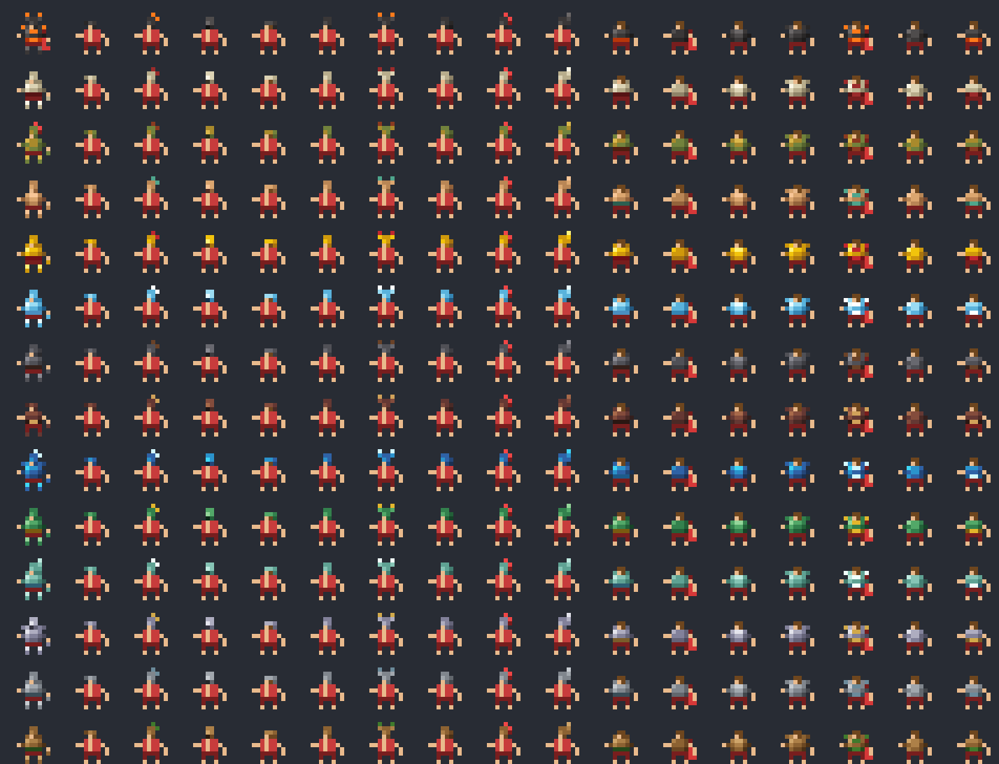

# Visible Armors

Equipped gear is drawn on the unit's body, the way Terraria draws armor on the player. Helmets sit on the head,
body armor covers the torso and sleeves, boots cover the feet, cloaks add a cape in the kingdom's colour, and
amulets hang on the chest. The look follows the item's **material**: a leather cap, a copper dome helm, a
bronze plumed helm, silver wings, an iron nasal helm, a steel great helm with a dark visor, a mythril crest and
glowing adamantine horns. The armor is part of each animation frame, so it walks, turns, fights, swims and
falls exactly with the unit.

* GUID `RAYTRACERX_VISIBLEARMORS` · version 0.1.0 · API level 1 · author RayTracerX
* Requires NeoModLoader (NML). Works next to PossessLib, MainCharacterMod, Expanded Armory and the rest of the
  mods in this folder (no shared IDs, save keys or resource paths).
* Stores nothing in saves. Remove the mod and units look vanilla again.



`docs/preview.png` shows every palette (rows) and style (columns) on a stand-in body, generated by
`tools/generate_art.py`. In game the pieces are fitted to the real sprite of every frame. In-game screenshots
from the self test are in `docs/screenshots/`: `grid_close.png` (rows human, elf, orc, dwarf; columns bare,
leather, copper, bronze, silver, iron, steel, mythril), `composites.png` (the actual armored sprites,
enlarged), `unit_window.png` and `other_species.png`.

## Install

Copy the `VisibleArmors` folder into `WorldBox/Mods/` and start the game. NML compiles the mod on first launch.
Errors, if any, go to `%USERPROFILE%\AppData\LocalLow\mkarpenko\WorldBox\Player.log` (search for `Visible Armors`).
A healthy start logs:

```
[Visible Armors]: Art loaded: 14 palettes, 9 helmet templates, 7 armor templates
[Visible Armors]: Appearance rules: 11 materials, 9 keywords, 0 items, 5 species
[Visible Armors]: Harmony: 3 patch classes applied, 0 failed
[Visible Armors]: Visible Armors 0.1.0 ready
```

## Config (NML mod settings)

| Option | Default | What it does |
|---|---|---|
| Show armor on units | on | Master switch. Off = vanilla sprites everywhere, at once. |
| Helmets / Body armor and cloaks / Boots / Amulets | on | One switch per piece. |
| Capes | on | The cape behind cloaks and ornate (adamantine) armor. |
| Also in the unit window portrait | on | Draw the same gear in unit-window and list portraits. |
| Other species | on | Animal civs, bandits, mages, demons... (see Species below). Off = only humans, elves, orcs, dwarves and zombies. |
| Hide armor when zoomed out further than | 80 | Camera size past which units show vanilla sprites. At about 80 and beyond the game stops drawing units anyway. |
| Sprite cache size | 8 | Number of 512x512 pages (1 MB each) for armored sprites. Old pages are recycled when full. |
| Debug logging and statistics | off | Logs how every item was resolved and, every 10 s, cache and timing stats. |

Changes apply on the next frame; no restart needed.

## What is drawn

* **Slots:** helmet, body armor, boots and amulet. Weapons are already drawn by the game. Rings are not drawn
  (one pixel on a hand reads as noise).
* **When:** living adults only. The game removes items when a unit dies, so armor disappears with them. Babies
  and eggs show none. **Kings keep their crown** instead of a helmet (change it with `keep_king_crown` in
  `appearances.json`).
* **Species:** humans, elves, orcs, dwarves and zombies use the tuned humanoid fit. Every other species that can
  carry items is checked once per sprite sheet: if it has an upright body with the head over the torso, it gets
  every piece (this covers the animal civs and the bandit, necromancer, alien, demon and mage units). Otherwise
  it gets the helmet only. The large animal-civ heads get rather boxy helmets; see Known issues.
* **Unknown items from other mods** still get a look. The style comes from keyword rules or the material, and the
  colours come from the material, or from the item's own icon if the material is unknown, or from a hue derived
  from the material name.

## Adding armor art

Everything is in `GameResources/visible_armors/`:

```
materials/<palette>.png   8x1 palette
helmets/<style>.png       5x5 helmet template
armor/<style>.png         5x4 torso template
appearances.json          which item gets which style and palette
```

All PNGs are plain RGBA images and can be edited in any pixel editor (Aseprite, GIMP, Paint.NET...). They are read
at startup, so restart the game after editing.

### Palettes (`materials/<id>.png`, 8x1)

Left to right: **outline, shadow, dark, mid, light, highlight, accent, dark accent**. The six shades are what
template greys map to; the accent is used for trims, gems, crests and horn tips. A palette whose id equals an
item's `material` is used automatically, so a new mod material `obsidian` only needs `materials/obsidian.png`.

### Templates (helmets 5x5, torso pieces 5x4)

Templates are **9-slice**: the middle column and middle row stretch to fit each head or torso, so one template
fits 2x2, 3x3 and 2x3 heads and every animation frame. Units face **left**.

```
Helmet (5x5)                        Torso (5x4)
col: front | head front | head middle* | head back | back      col: front arm | torso front | middle* | torso back | back arm
row 1: 2 px above the head (horns, plumes)                      row 1: shoulders (beside the neck: pauldrons)
row 2: 1 px above the head (dome)                               row 2: torso top
row 3: head top row                                             row 3: torso middle*
row 4: head middle rows*                                        row 4: torso bottom (belt)
row 5: head bottom row (face level)                             (* stretches; it is dropped when the part is only 2 px)
```

Pixel colours:

| Pixel | Meaning |
|---|---|
| transparent | leave the unit's pixel alone |
| grey `#000000` `#333333` `#666666` `#999999` `#CCCCCC` `#FFFFFF` | palette shade 0..5 (outline ... highlight) |
| `#FF0000` / `#800000` | palette accent / dark accent |
| `#FF00FF` / `#800080` | the unit's kingdom colour / dark kingdom colour |
| `#00FF00` | keep the unit's pixel (mark the face so it stays visible) |
| `#00FFFF` | visor: darkest shade, and the only colour that may cover the face |
| **opaque** pixel | paints even where the unit has no pixel, which changes the silhouette (domes, horns, pauldrons) |
| **semi-transparent** pixel (alpha < 250) | only recolours pixels the unit already has (use it for sleeves on the arm columns) |

Helmets never cover the body and keep the face unless you use the visor colour. Torso pieces never cover the head.

### Boots, capes and amulets

Boots are fitted to the feet procedurally. Their styles live in `appearances.json` (`height` 1–4 px,
`shade` and `top_shade` 0–5, `accent_cuff`). A torso style gets a cape through `"capes": { "<style>": "kingdom" | "material" }`.
Amulets are a gem pixel in the palette's accent colour with a chain pixel above it.

### `appearances.json`

```json
"materials": { "steel": { "helmet": "great_helm", "armor": "plate", "boots": "greaves", "amulet": "pendant" } },
"keywords":  [ { "match": "cloak", "slot": "armor", "style": "cloak" }, { "match": "ice_", "palette": "ice" } ],
"items":     { "helmet_adamantine": { "style": "horned", "palette": "adamantine" } },
"species":   { "human": "humanoid", "civ_cat": "head_only", "default": "auto" }
```

Resolution order per item: API, then `items`, then `keywords` (substring of the item id; the first match wins for
style and palette separately), then `materials[<item material>]`, then `materials.default`.

### Regenerating the art

`python tools/generate_art.py` rewrites the generated PNGs, `icon.png` and `docs/preview.png` from the
definitions at the top of the script. It needs plain Python 3 and no packages. **It overwrites edits made to
those PNGs**, so either edit the script or the PNGs. `python tools/generate_art.py --preview` only redraws the
preview from the PNGs on disk.

## For other mods (API)

Items that are normal `EquipmentAsset`s (PossessLib, SurvivalBox, item packs) already work with no code.
To pick a specific look, declare Visible Armors as an optional dependency and call the API from `OnModLoad`:

```csharp
#if RAYTRACERX_VISIBLEARMORS
using UnityEngine;
using VisibleArmors.Api;

VisibleArmorsApi.RegisterPalette("obsidian", new Color32[] {
    new Color32(10, 8, 16, 255), new Color32(24, 18, 36, 255), new Color32(40, 30, 60, 255), new Color32(60, 46, 90, 255),
    new Color32(88, 70, 128, 255), new Color32(140, 120, 190, 255), new Color32(200, 60, 255, 255), new Color32(90, 20, 120, 255) });
VisibleArmorsApi.SetItemLook("helmet_obsidian", "horned", "obsidian");   // style id, palette id (null = automatic)
VisibleArmorsApi.SetItemLook("armor_obsidian", "plate_ornate", "obsidian");
VisibleArmorsApi.SetSpeciesProfile("my_lizardman", "humanoid");           // humanoid | head_only | auto | none
#endif
```

Also available: `RegisterTemplate(ArmorSlot, id, pixels, width, height)`, `RegisterBootsStyle(...)`,
`Refresh(actor)`, `RefreshAll()` and `IsArmorDrawn(actor)`. Equipment changes are picked up automatically every
frame, so `Refresh` is rarely needed. Call the API on the main thread.

## Performance

Measured in game (details in `docs/DESIGN.md`): with about 780 units on screen, 600–730 of them armored and
walking, frame time was 13.8 ms with the mod vs 13.2 ms without (+0.3 to 0.6 ms). Armored sprites are built once
per frame image and cached (about 0.015 ms each). The cache is capped (8 MB by default). The game's own sprite
memory is not touched.

## Testing

### Automated self test

Create an empty file `selftest.flag` in this folder (write `quit` in it to close the game afterwards) and start the
game. It spawns a grid of every species × material, checks equip/unequip/swap, death, the zoom limit, every
switch, moving units, the unit window, a save/load round trip (into `debug/`, never your save slots), an
800-unit stress test and cache eviction. It writes screenshots and a PNG sheet of all armored sprites to
`debug/selftest/`, and logs `[SelfTest] PASS/FAIL` lines plus a `SUMMARY`. It spawns and then removes test units in
the current world, so run it on a world you don't mind changing, and don't save afterwards. Delete the flag file
when done. `dump_sprites.flag` exports the game's unit sprites to `debug/dump/` (only useful for drawing new art;
do not share that folder, it contains game art).

### Manual checklist

1. Spawn humans, elves, orcs and dwarves. In the unit window, equip a helmet, armor and boots of different materials.
   The unit in the world and the portrait update at once.
2. Remove one piece: only that piece disappears.
3. Watch them walk, turn, fight and swim. The armor stays on the body in every frame.
4. Kill an armored unit: the corpse is plain (the game drops the gear).
5. Zoom out past the zoom limit (or set it low): vanilla sprites. Zoom in: armor again.
6. Save, load: armor is back with no extra data.
7. Toggle each switch in the mod settings: the change shows on the next frame.
8. In the log, with debug on: `[debug] Item ... -> style ..., palette ...` for every item and `[stats]` every 10 s.
   Any `Composing armor for ...` or `postfix` error line is a bug; please send the lines around it.

## Known issues and placeholders

* The art is generated pixel art at the game's own scale. Each material is clearly different (colour plus
  silhouette), but the templates are simple first versions meant to be improved (see "Adding armor art").
* Animal civs (cat, dog, bear, rhino...) get rather boxy helmets on their big heads, and their torsos are fitted
  heuristically. Turn "Other species" off, or set them to `head_only` or `none`, if you don't like it.
* Plumes and capes use the kingdom colour; wild (kingdomless) units get the game's neutral colours.
* Armored and plain units use different textures, so the game batches them separately. This is included in the
  numbers above.
* If an item from another mod breaks the game's own item generation (seen with some ShinobiBox items), that is
  outside this mod. Its look is still resolved normally once the item exists.
* In one save/load test with such broken items in the world, one unit came back from the load with a different
  amulet than it had before saving. The drawing matched what it wore after the load. It looks like a game-side
  item-identity issue and was not investigated further.
